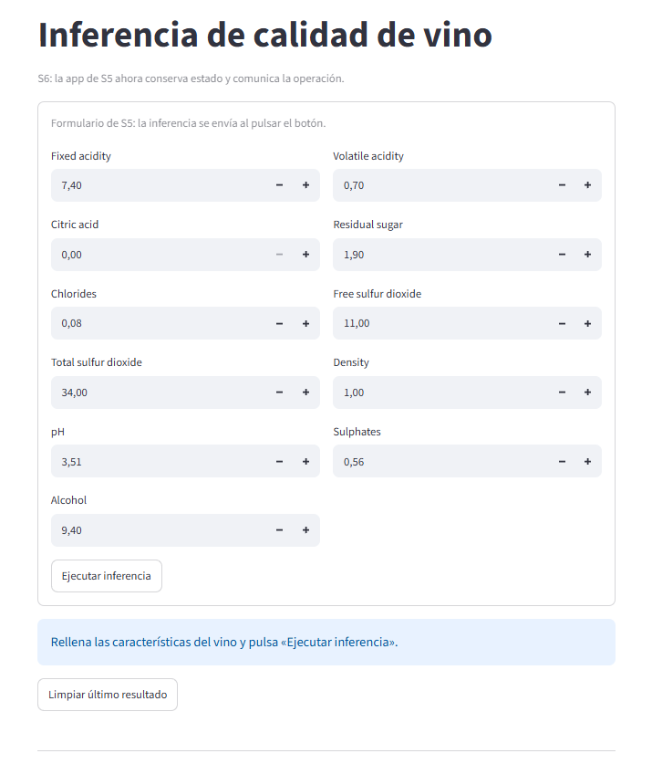
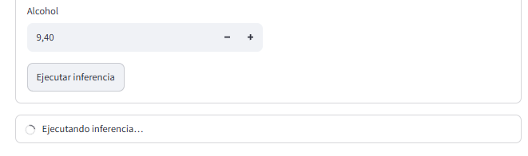
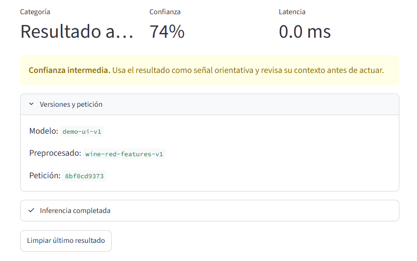
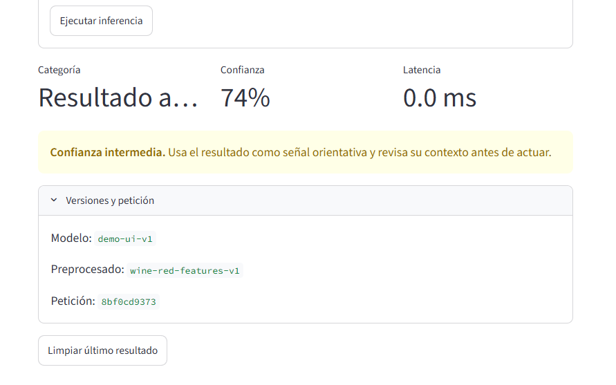
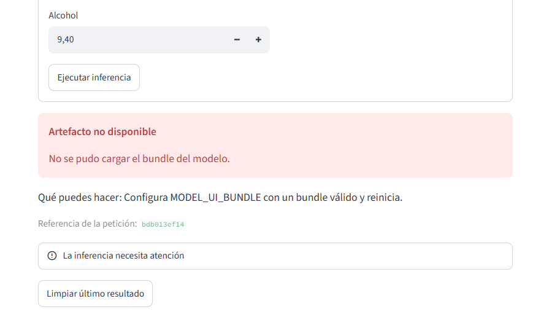
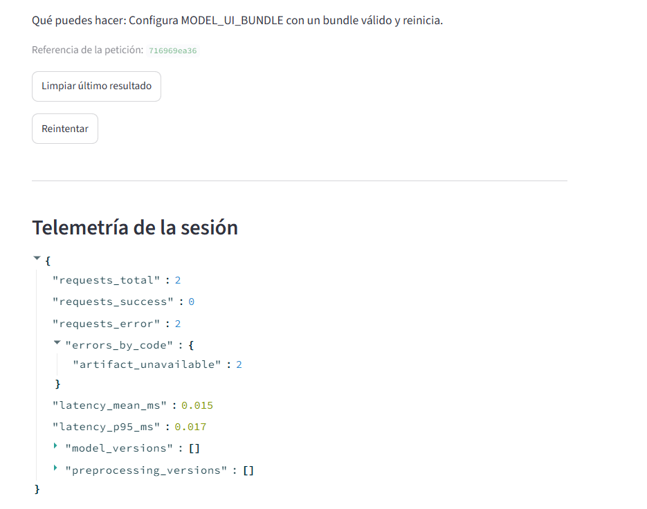
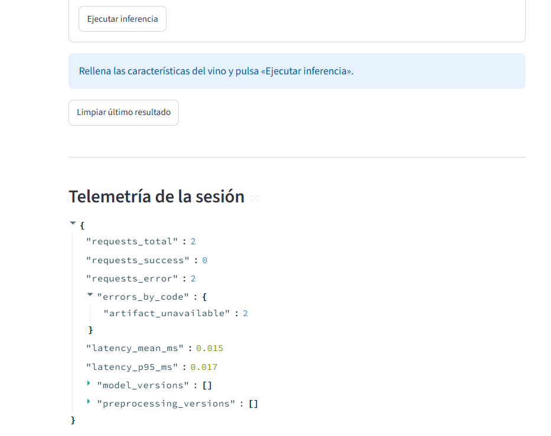
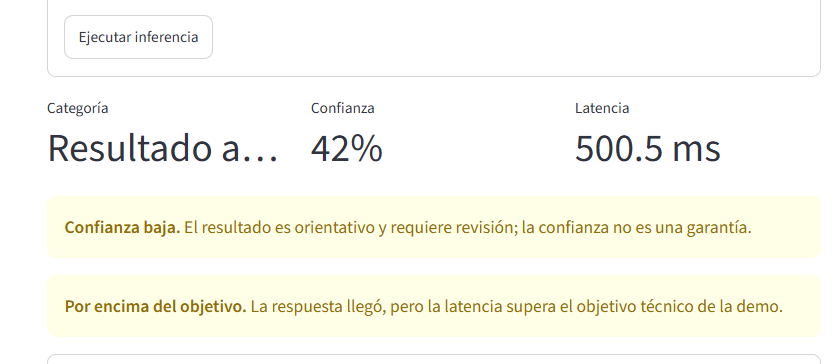
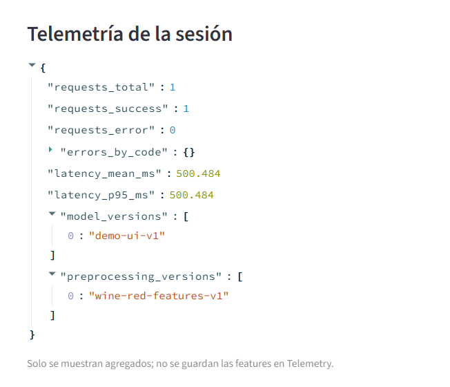

# Evidencia - Assignment 6.2

App de S5 refactorizada con estado explícito, gateway cacheado y UX operable.

## 1. Diff de evolución

Se conserva de S5, sin cambios:

- `FEATURE_FIELDS` con las 11 features y sus límites.
- `collect_values()`: un único `st.form` y `st.form_submit_button`.
- `build_gateway()`, `DemoGateway`, `UnavailableGateway` y `PackagedBundleGateway`.
- El contrato de S4 (`PredictionPayload`) y los errores de dominio de `errors.py`.

Se añade en S6:

| Archivo | Qué se añade |
|---|---|
| `session.py` | Inicialización idempotente con `setdefault` de `last_state`, `telemetry` y `last_values`. `clear_last_state` vuelve a `idle` sin tocar la telemetría. |
| `policies.py` | Confianza `low` (< 0.60), `medium` y `high` (>= 0.85). Latencia `within_target` (<= 300 ms) o `above_target`. |
| `presentation.py` | `build_prediction_view` (etiquetas, copy de confianza y latencia, versiones) y `to_user_facing_error` (código estable, mensaje, recuperación y `request_id`, sin detalle técnico). |
| `controller.py` | `submit()` emite `loading`, mide la latencia, valida que la salida sea un `PredictionPayload`, traduce excepciones, registra agregados y termina en `success` o `error`. |
| `app.py` | Gateway con `st.cache_resource`, estado en `st.session_state`, `st.empty` + `st.status` para la operación, métricas, avisos, expander de versiones, y botones de reintentar y limpiar. |

## 2. Tests

```
$ uv run pytest -q
8 passed

$ uv run ruff check .
All checks passed!

$ uv run ruff format --check .
15 files already formatted
```

## 3. Recorridos en la app

Arranque con `uv run streamlit run app.py`. Sin `MODEL_UI_BUNDLE` se usa el `DemoGateway`.

### Inicio

Se muestra la instrucción "Rellena las características del vino y pulsa «Ejecutar inferencia»", sin resultado vacío.



### Loading

Al enviar, `st.status` muestra "Ejecutando inferencia…".



### Éxito

Tres métricas (categoría, confianza y latencia), aviso de confianza y expander con versiones y `request_id`.



### Rerun

Tras forzar un rerun (tecla `R` o menú ⋮ > Rerun), el último resultado sigue visible porque se lee de `st.session_state`.



### Error

Con `MODEL_UI_BUNDLE=/no/existe` se muestra "Artefacto no disponible", qué hacer y la referencia de la petición. No aparece traceback ni la ruta.



### Reintentar

"Reintentar" vuelve a enviar solo los últimos valores. Se genera un `request_id` nuevo y `requests_total` sube en 1.



### Limpiar

"Limpiar último resultado" vuelve a `idle`. La telemetría conserva sus contadores.



## 4. Confianza baja y latencia alta

Con `DemoGateway(confidence=0.42, delay_seconds=0.5)` el controlador produce:

```
low          | Confianza baja          | El resultado es orientativo y requiere revisión; la confianza no es una garantía.
above_target | Por encima del objetivo | La respuesta llegó, pero la latencia supera el objetivo técnico de la demo.
```

La respuesta lenta sigue siendo `success`. La confianza se muestra como métrica y aviso, nunca con `st.progress`.



## 5. Caché

Se cachea el gateway (`build_gateway(bundle_value)`) con `st.cache_resource`. Carga el bundle una vez y no por cada rerun. Su único argumento es la ruta del bundle, así que no contiene datos de ninguna petición. La respuesta de cada persona no se cachea, vive en `st.session_state` de su sesión.

## 6. Telemetría sin features

Solo hay contadores, códigos de error, latencias y versiones. No aparecen nombres ni valores de las features, ni la ruta del bundle.



## 7. Decisiones que se conservan para S7 (HTTP)

- `InferenceGateway` es la única frontera, en S7 basta con un gateway HTTP que cumpla el mismo `predict(values) -> PredictionPayload`.
- `PredictionController` no importa Streamlit, así que funciona igual con el gateway HTTP.
- Toda salida se valida como `PredictionPayload` antes de llegar a la vista.
- Los fallos se traducen a errores de dominio (`InputContractError`, `ArtifactUnavailableError`, `InferenceTimeoutError`, `BackendInferenceError`). El cliente HTTP solo tiene que mapear 422, 503, timeout y error de conexión a esos tipos.
- Sesión, presentación, telemetría y caché del gateway no cambian, solo se sustituye el objeto que devuelve `build_gateway()`.
