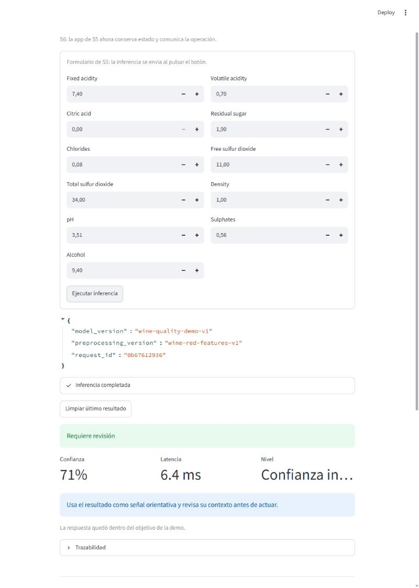
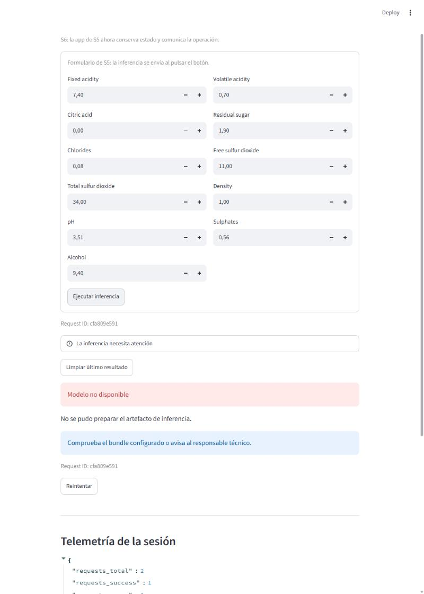
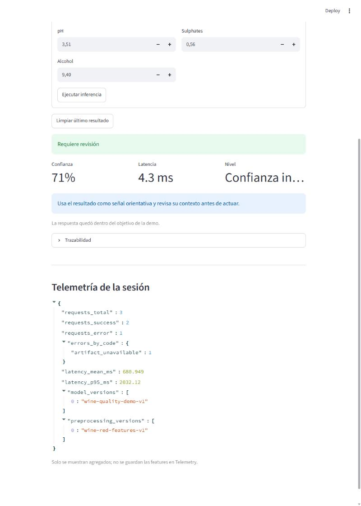

# Evidencias — Assignment 7.2: de gateway local a cliente HTTP

Comprobaciones realizadas el 11/11/2026 desde
`semana7/modules/07-http-rest-clients/exercises/03-wine-http-gateway/problem/starter`.

## 1. Cliente HTTP y wiring

| Pieza | Fichero | Qué hace |
| --- | --- | --- |
| Petición | `src/model_ui/http_gateway.py` | `POST /v1/predictions` con `json={"features": values}`, `Accept: application/json` y `timeout=self._timeout`. |
| Validación de salida | `src/model_ui/http_gateway.py` | `_read_object` exige un objeto JSON; `body["prediction"]` se valida con `PredictionPayload.model_validate` antes de llegar al controlador. |
| Traducción de errores | `src/model_ui/http_gateway.py` | `422` → `InputContractError`; `503` y `ConnectionError` → `ArtifactUnavailableError`; `Timeout` → `InferenceTimeoutError`; otro status o `RequestException` → `BackendInferenceError`. Ningún mensaje incluye cuerpo de respuesta, traceback ni features. |
| Trazabilidad | `src/model_ui/http_gateway.py` | `last_request_id` prioriza `body["request_id"]` y usa `X-Request-Id` como alternativa. |
| Wiring | `app.py` | `build_gateway` prioriza `HttpInferenceGateway(api_url)` si `MODEL_API_URL` tiene valor; el gateway se crea con `st.cache_resource` y se inyecta en el mismo `PredictionController` de S6. |

Cambios fuera de `http_gateway.py`: 2 líneas en `app.py` (TODO S7.5) y
`pythonpath = [".", "src"]` en `pyproject.toml`, necesario para que
`tests/test_app_gateway_selection.py` pueda importar `app.py` (con solo `src`
la recolección falla). La UI, el controlador, el estado de sesión, la
presentación y la telemetría de S6 no se han tocado.

## 2. Pytest y Ruff

```text
$ uv run pytest -q
..................................                                       [100%]
34 passed in 0.33s

$ uv run ruff check src tests app.py
All checks passed!

$ uv run ruff format --check src tests app.py
17 files already formatted
```

Los tests del cliente usan sesiones y respuestas simuladas, no dependen de un
servidor real.

## 3. Recorrido con la API Wine local

```text
# Terminal 1 (desde semana7/modules/07-http-rest-clients)
uv run python examples/wine-quality-api/server.py

# Terminal 2 (desde el starter)
MODEL_API_URL=http://127.0.0.1:8000 uv run streamlit run app.py
```

Salud de la API caja negra:

```text
$ curl -i http://127.0.0.1:8000/health
HTTP/1.1 200 OK
Server: S7WineQualityAPI/1.0 Python/3.12.14
Content-Type: application/json; charset=utf-8
X-Request-Id: req_db99aa9a6390

{"status": "ok", "service": "wine-quality-prediction", "model_status": "ready", "model_version": "wine-quality-demo-v1", "request_id": "req_db99aa9a6390"}
```

### 3.1 Éxito

Con los valores por defecto del formulario, la app muestra **Requiere
revisión**, confianza **71 %**, latencia 6,4 ms, `model_version`
`wine-quality-demo-v1` y `preprocessing_version` `wine-red-features-v1`. Es
exactamente lo que devuelve la API para esa muestra:

```json
{"prediction": {"quality_band": "needs_review", "confidence": 0.71, "model_version": "wine-quality-demo-v1", "preprocessing_version": "wine-red-features-v1"}, "request_id": "req_7a283c5ed351"}
```



### 3.2 Fallo recuperable traducido

Con la app abierta se detiene la API (puerto 8000 libre) y se vuelve a pulsar
"Ejecutar inferencia". El `ConnectionError` se traduce a
`ArtifactUnavailableError` y la app muestra **Modelo no disponible**, un
consejo de acción, el Request ID y el botón **Reintentar**. No aparece
traceback, cuerpo interno ni valores de features.



### 3.3 Recuperación

Se vuelve a arrancar la API y se pulsa **Reintentar**: la predicción vuelve a
completarse. La telemetría de la sesión solo guarda agregados:

```json
{
  "requests_total": 3,
  "requests_success": 2,
  "requests_error": 1,
  "errors_by_code": {"artifact_unavailable": 1},
  "model_versions": ["wine-quality-demo-v1"],
  "preprocessing_versions": ["wine-red-features-v1"]
}
```



Nota: el Request ID que muestra la app es el que genera `PredictionController`
para la sesión (diseño de S6). El `request_id` de la API (`req_…`) queda en
`HttpInferenceGateway.last_request_id`.
